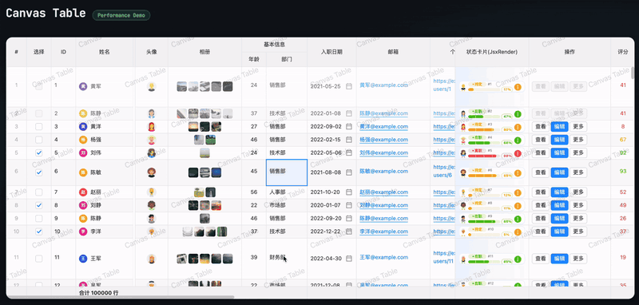

# Canvas Table

**English** | [简体中文](README.zh-CN.md)

[](https://www.npmjs.com/package/@canvas-table/core)
[](https://www.npmjs.com/package/@canvas-table/core)
[](https://github.com/DingRui12138/CanvasTable/blob/main/LICENSE)
[](https://bundlephobia.com/package/@canvas-table/core)
[](https://dingrui12138.github.io/CanvasTable/)

A high-performance data table component built on Canvas that renders millions of rows smoothly.

- npm package: [`@canvas-table/core`](https://www.npmjs.com/package/@canvas-table/core)
- Source and issues: [DingRui12138/CanvasTable](https://github.com/DingRui12138/CanvasTable)
- **Live demo**: [https://dingrui12138.github.io/CanvasTable/](https://dingrui12138.github.io/CanvasTable/)
- **React example (CodeSandbox)**: [https://codesandbox.io/p/sandbox/w9rm69](https://codesandbox.io/p/sandbox/w9rm69)



## Features

### Core capabilities
- **Virtual scrolling** - renders only the visible area, supporting millions of rows
- **Multi-level headers** - supports column groups nested to any depth
- **Fixed columns** - supports left and right fixed columns
- **Pinned rows** - right-click to pin a row to the top or bottom
- **Summary rows** - supports top/bottom summaries, current-view/full-data scope, and cross-column summary cells
- **Merged cells** - supports row merging and column merging
- **Hierarchical data** - supports tree-structured display with expand/collapse

### Column types
- `text` - text
- `number` - number
- `date` - date
- `checkbox` - checkbox
- `radio` - radio button
- `switch` - switch
- `button` - button (supports default, primary, danger, warning, and link variants)
- `tag` - tag (supports single and multiple selection)
- `select` - dropdown select
- `input` - input (supports multiple lines)
- `image` - image (single/multiple images, upload, preview)
- `progress` - progress bar (line, circle, and dashboard shapes, color ranges)
- `custom` - custom rendering

### Interactions
- **Sorting** - single-column/multi-column sorting, ascending and descending
- **Filtering** - column filtering
- **Selection** - cell, row, and column selection, with range selection and multi-select
- **Editing** - enter edit mode by double-clicking or pressing Enter
- **Context menu** - delete row, insert row above, insert row below, pin/unpin row
- **Keyboard navigation** - arrow-key navigation and keyboard shortcuts
- **Undo** - Ctrl+Z (Windows/Linux) / Cmd+Z (macOS)
- **Redo** - Ctrl+Y (Windows/Linux) / Cmd+Y (macOS)

### Other features
- **Themes** - light, dark, and auto theme modes, with customizable theme colors
- **Localization** - built-in Chinese/English messages, with runtime switching and custom message overrides
- **Watermark** - customizable watermark content and style
- **Export** - export to CSV, JSON, and Excel
- **Responsive** - responsive layout that adapts to the container size

## Installation

```bash
npm install @canvas-table/core
```

Or with pnpm / yarn:

```bash
pnpm add @canvas-table/core
yarn add @canvas-table/core
```

The package ships ESM, UMD, and TypeScript type declarations, with no runtime dependencies.

## Quick start

```typescript
import { CanvasTable } from '@canvas-table/core';
import type { Column, Row } from '@canvas-table/core';

const columns: Column[] = [
  { key: 'id', title: 'ID', width: 80, type: 'number' },
  { key: 'name', title: 'Name', width: 120, editable: true },
  { key: 'age', title: 'Age', width: 80, type: 'number', sortable: true },
  { key: 'department', title: 'Department', width: 120 }
];

const rows: Row[] = [
  { data: { id: 1, name: 'Alice', age: 28, department: 'Engineering' } },
  { data: { id: 2, name: 'Bob', age: 32, department: 'Marketing' } }
];

const container = document.getElementById('table-container')!;

const table = new CanvasTable(container, {
  rows,
  columns,
  width: '100%',
  height: 600,
  stripeRows: true,
  hoverable: true,
  themeMode: 'auto',
  selection: { mode: 'cell', multi: true },
  editing: { enabled: true, mode: 'dblclick' }
});
```

### CDN / UMD

Use a `<script>` tag directly without a build tool:

```html
<div id="table-container" style="height: 600px"></div>

<script src="https://unpkg.com/@canvas-table/core/dist/canvas-table.umd.min.js"></script>
<script>
  const { CanvasTable } = window.CanvasTable;

  new CanvasTable(document.getElementById('table-container'), {
    rows: [{ data: { id: 1, name: 'Alice' } }],
    columns: [{ key: 'id', title: 'ID', width: 80 }, { key: 'name', title: 'Name', width: 160 }],
    height: 600
  });
</script>
```

The UMD global is named `CanvasTable`, and all named exports are attached to it.

### Using with React

A runnable React example is available on CodeSandbox: [https://codesandbox.io/p/sandbox/w9rm69](https://codesandbox.io/p/sandbox/w9rm69)

```tsx
import { useEffect, useRef } from 'react';
import { CanvasTable, type Column, type Row } from '@canvas-table/core';

export function DataTable({ rows, columns }: { rows: Row[]; columns: Column[] }) {
  const containerRef = useRef<HTMLDivElement>(null);
  const tableRef = useRef<CanvasTable | null>(null);

  useEffect(() => {
    if (!containerRef.current) return;
    const table = new CanvasTable(containerRef.current, { rows, columns, height: 600 });
    tableRef.current = table;
    return () => {
      table.destroy();
      tableRef.current = null;
    };
  }, []);

  useEffect(() => {
    tableRef.current?.setColumns(columns);
    tableRef.current?.setRows(rows);
  }, [rows, columns]);

  return <div ref={containerRef} style={{ width: '100%', height: 600 }} />;
}
```

### Using with Vue

```vue
<script setup lang="ts">
import { onBeforeUnmount, onMounted, ref, shallowRef, watch } from 'vue';
import { CanvasTable, type Column, type Row } from '@canvas-table/core';

const props = defineProps<{ rows: Row[]; columns: Column[] }>();
const container = ref<HTMLDivElement | null>(null);
const table = shallowRef<CanvasTable | null>(null);

onMounted(() => {
  table.value = new CanvasTable(container.value!, {
    rows: props.rows,
    columns: props.columns,
    height: 600
  });
});

watch(
  () => [props.rows, props.columns],
  () => {
    table.value?.setColumns(props.columns);
    table.value?.setRows(props.rows);
  }
);

onBeforeUnmount(() => table.value?.destroy());
</script>

<template>
  <div ref="container" style="width: 100%; height: 600px" />
</template>
```

> The table relies on a real DOM and a Canvas 2D context, so it does not participate in SSR. Create the instance only after client-side mount (React's `useEffect`, Vue's `onMounted`, or a dynamic import with `ssr: false` in Next.js).

## Configuration options

### TableOptions

| Property | Type | Default | Description |
|------|------|--------|------|
| `rows` | `Row[]` | - | Table row data |
| `columns` | `Column[]` | - | Table column definitions |
| `width` | `number \| '100%'` | `'100%'` | Table width |
| `height` | `number \| '100%'` | `'100%'` | Table height |
| `stripeRows` | `boolean` | `false` | Whether to show zebra stripes |
| `hoverable` | `boolean` | `true` | Whether to enable the row hover effect |
| `themeMode` | `'light' \| 'dark' \| 'auto'` | `'auto'` | Theme mode |
| `theme` | `TableTheme` | - | Custom theme |
| `selection` | `SelectionOptions` | - | Selection options |
| `editing` | `EditingOptions` | - | Editing options |
| `watermark` | `WatermarkOptions` | - | Watermark options |
| `loadingText` | `string` | locale.loadingText | Loading overlay text |
| `emptyText` | `string` | locale.emptyText | Empty data text |
| `locale` | `LocaleConfig` | `'zh-CN'` | Localized message configuration; supports `'zh-CN'`, `'en-US'`, or partial overrides |
| `lazyLoad` | `LazyLoadConfig` | - | Lazy loading options |
| `imageLoad` | `ImageLoadConfig` | - | Image loading options |
| `rowHeight` | `(row: Row, rowIndex: number) => number` | - | Dynamic row height function; uses the theme default row height when not specified |
| `enableRowHeightResize` | `boolean` | `false` | Whether to enable drag-to-resize row height |
| `rowResizable` | `boolean \| ((row: Row, rowIndex: number) => boolean)` | `true` | Whether row height can be resized, configurable per row |
| `enableRowPinning` | `boolean` | `false` | Whether to enable right-click pinning of rows to the top/bottom |
| `rowPinnable` | `boolean \| ((row: Row) => boolean)` | `true` | Whether a row can be pinned, configurable per row |
| `summary` | `SummaryConfig` | - | Summary row configuration; supports top/bottom and current-view/full-data scope |
| `createRowData` | `(columns: Column[]) => Record<string, unknown>` | - | Data initialization function used when adding a new row |

### Column configuration

```typescript
interface Column {
  key: string;                    // Column identifier
  title: string;                  // Column title
  width?: number;                 // Column width
  type?: ColumnType;              // Column type
  align?: 'left' | 'center' | 'right';  // Alignment
  fixed?: 'left' | 'right';       // Fixed column
  sortable?: boolean;             // Whether sortable
  filterable?: boolean;           // Whether filterable
  editable?: boolean;             // Whether editable
  formatter?: (value: unknown) => string;  // Formatter
  placeholder?: string;            // Placeholder shown for empty values (applies to number and other column types)
  render?: (value: unknown, row: Row, rowIndex: number) => CellRenderResult;  // Custom rendering
  editRender?: (value: unknown, row: Row, rowIndex: number) => EditRenderResult;  // Edit rendering
  children?: Column[];            // Child columns (multi-level headers)
}
```

### Column type examples

#### Checkbox column

```typescript
{
  key: 'selected',
  title: 'Select',
  width: 60,
  type: 'checkbox',
  render: (value, row) => ({
    type: 'checkbox',
    checkbox: {
      checked: Boolean(value)
    }
  })
}
```

#### Radio column

```typescript
{
  key: 'priority',
  title: 'Priority',
  width: 150,
  type: 'radio',
  render: (value, row) => ({
    type: 'radio',
    radio: {
      value: value as string,
      options: [
        { label: 'High', value: 'high' },
        { label: 'Medium', value: 'medium' },
        { label: 'Low', value: 'low' }
      ]
    }
  })
}
```

#### Switch column

```typescript
{
  key: 'enabled',
  title: 'Enabled',
  width: 80,
  type: 'switch',
  render: (value, row) => ({
    type: 'switch',
    switch: {
      checked: Boolean(value)
    }
  })
}
```

#### Button column

```typescript
{
  key: 'action',
  title: 'Actions',
  width: 80,
  type: 'button',
  render: () => ({
    type: 'button',
    button: {
      text: 'Edit',
      variant: 'primary',  // default | primary | danger | warning | link
      size: 'small'        // small | medium | large
    }
  })
}
```

#### Tag column

```typescript
{
  key: 'status',
  title: 'Status',
  width: 100,
  type: 'tag',
  render: (value) => ({
    type: 'tag',
    tags: {
      tags: [{ text: 'Active', value: 'active', bgColor: '#52c41a', color: '#fff' }],
      editable: true,
      multiple: false,  // single-select mode
      options: [
        { text: 'Active', value: 'active', bgColor: '#52c41a', color: '#fff' },
        { text: 'Inactive', value: 'inactive', bgColor: '#ff4d4f', color: '#fff' }
      ]
    }
  })
}
```

#### Select column

```typescript
{
  key: 'level',
  title: 'Level',
  width: 120,
  type: 'select',
  render: (value) => ({
    type: 'select',
    select: {
      value: value as string,
      options: [
        { label: 'Junior', value: 'junior' },
        { label: 'Mid-level', value: 'middle' },
        { label: 'Senior', value: 'senior' }
      ],
      placeholder: 'Please select'
    }
  })
}
```

#### Progress column

```typescript
// Basic line progress bar
{
  key: 'progress',
  title: 'Progress',
  width: 120,
  render: (value) => ({
    type: 'progress',
    progress: {
      value: value as number,
      shape: 'line',           // line shape
      size: 'medium',          // small | medium | large
      showText: true,
      textPosition: 'right'    // inside | right
    }
  })
}

// Progress bar with color ranges (changes color automatically based on progress)
{
  key: 'completion',
  title: 'Completion',
  width: 150,
  render: (value) => ({
    type: 'progress',
    progress: {
      value: value as number,
      color: [
        { value: 0, color: '#ff4d4f' },     // red
        { value: 50, color: '#faad14' },    // yellow
        { value: 100, color: '#52c41a' }    // green
      ]
    }
  })
}

// Circle progress bar
{
  key: 'score',
  title: 'Score',
  width: 80,
  render: (value) => ({
    type: 'progress',
    progress: {
      value: value as number,
      shape: 'circle',         // ring
      size: 'small',
      format: (v) => `${v} pts`
    }
  })
}

// Dashboard progress bar
{
  key: 'dashboard',
  title: 'Dashboard',
  width: 100,
  render: (value) => ({
    type: 'progress',
    progress: {
      value: value as number,
      shape: 'dashboard',      // dashboard (semicircle)
      size: 'medium',
      status: 'success'        // normal | success | warning | error
    }
  })
}

// Interactive progress bar (click to adjust)
{
  key: 'volume',
  title: 'Volume',
  width: 100,
  render: (value) => ({
    type: 'progress',
    progress: {
      value: value as number,
      interactive: true,       // allow click-to-adjust
      shape: 'line'
    }
  })
}

// Custom rounded progress bar
{
  key: 'custom',
  title: 'Custom',
  width: 120,
  render: (value) => ({
    type: 'progress',
    progress: {
      value: value as number,
      shape: 'line',
      borderRadius: 0,         // right angles (defaults to half the height, capsule shape)
      height: 12               // custom height
    }
  })
}
```

#### Custom rendering

```typescript
{
  key: 'name',
  title: 'Name',
  width: 140,
  render: (value, row, rowIndex) => ({
    type: 'custom',
    customRender: (context) => {
      const { ctx, x, y, width, height, padding, theme } = context;
      // Draw with the Canvas API
      ctx.fillStyle = theme.colors.cellText;
      ctx.fillText(String(value), x + padding, y + height / 2);
    }
  })
}
```

#### Custom rendering + editing

When using `type: 'custom'` custom rendering, you can specify the control used for editing through `editRender`:

```typescript
{
  key: 'priority',
  title: 'Priority',
  width: 100,
  editable: true,
  // Custom display: icon + text
  render: (value, row) => {
    const icons: Record<string, string> = { high: '🔴', medium: '🟡', low: '🟢' };
    return {
      type: 'custom',
      customRender: (ctx) => {
        const { ctx: c, x, y, width, height, padding } = ctx;
        c.font = '14px sans-serif';
        c.fillText(`${icons[value as string] || ''} ${value}`, x + padding, y + height / 2);
      }
    };
  },
  // Use a select dropdown while editing
  editRender: (value, row, rowIndex) => ({
    type: 'select',
    select: {
      options: [
        { label: '🔴 High', value: 'high' },
        { label: '🟡 Medium', value: 'medium' },
        { label: '🟢 Low', value: 'low' }
      ]
    }
  })
}
```

#### JSX shared components

CanvasTable provides shared JSX components for declarative layout inside `jsxRender`. `jsxRender` draws from the top-left corner of the cell, without applying the built-in padding or centering; styling is entirely up to you. The root element fills the cell by default (`width: "100%"`, `height: "100%"`).

**Available components:** `CTBox`, `CTRow` (= `CTBox { direction: "row" }`), `CTColumn` (= `CTBox { direction: "column" }`), `CTStack` (= `CTBox`), `CTText`, `CTCircle`, `CTImage`, `CTLine`, `CTProgress`, `CTDate`, `CTTooltip`, `CTDropdown`, plus `createCTElement`

> All JSX components are exported from both `@canvas-table/core` and `@canvas-table/core/jsx`. Their prop types (`BoxProps`, `TextProps`, `CTElement`, ...) are exported **only** from `@canvas-table/core/jsx`. The `CT` prefix keeps them from shadowing table types (`Row` / `Column`) or DOM globals (`Date` / `Image` / `Text`).

```typescript
import type { CTElement, BoxProps, TextProps } from '@canvas-table/core/jsx';
```

**Example:**

```typescript
import { createCTElement, CTBox, CTText, CTRow, CTColumn, CTCircle } from '@canvas-table/core';

{
  key: 'status',
  title: 'Status',
  width: 180,
  type: 'custom',
  render: () => ({
    type: 'custom',
    jsxRender: () =>
      createCTElement(
        CTBox,
        { width: "100%", height: "100%", justify: "center", align: "center", overflow: "hidden" },
        createCTElement(
          CTRow,
          { gap: 8, align: "center" },
          createCTElement(CTCircle, { radius: 4, bgColor: '#52c41a' }),
          createCTElement(CTColumn, { gap: 2 },
            createCTElement(CTText, { text: 'Online', fontWeight: 'bold' }),
            createCTElement(CTText, { text: 'Updated just now', fontSize: 12, color: '#8c8c8c' }),
          ),
        ),
      ),
  }),
}
```

##### CTBox / CTRow / CTColumn / CTStack props

CTRow is `CTBox { direction: "row" }`, CTColumn is `CTBox { direction: "column" }`, and CTStack is an alias for CTBox.

**Layout props:**

| Property | Alias | Type | Default | Description |
| --- | --- | --- | --- | --- |
| `display` | — | `"flex"` | `"flex"` | Flex layout mode |
| `position` | — | `"relative"` | — | Positioning mode; children are positioned with x/y |
| `flexDirection` | `direction` | `"row" \| "column" \| "row-reverse" \| "column-reverse"` | `"row"` | Main axis direction |
| `justifyContent` | `justify` | `"flex-start" \| "flex-end" \| "center" \| "space-between" \| "space-around" \| "space-evenly"` | `"flex-start"` | Main axis alignment |
| `alignItems` | `align` | `"flex-start" \| "flex-end" \| "center" \| "stretch"` | `"flex-start"` | Cross axis alignment |
| `alignSelf` | `selfAlign` | `"flex-start" \| "flex-end" \| "center" \| "stretch"` | — | Cross axis alignment override for a single child |
| `gap` | — | `number` | `0` | Spacing between children |
| `padding` | — | `number \| { top?, right?, bottom?, left? }` | `0` | Inner padding |
| `margin` | `mg` | `number \| { top?, right?, bottom?, left? }` | `0` | Outer margin |

**Size props:**

| Property | Alias | Type | Default | Description |
| --- | --- | --- | --- | --- |
| `width` | — | `number \| string` | `"100%"` (root element) | Width, supports percentage `"100%"` |
| `height` | — | `number \| string` | `"100%"` (root element) | Height, supports percentage `"100%"` |
| `minWidth` | `minW` | `number \| string` | — | Minimum width |
| `maxWidth` | `maxW` | `number \| string` | — | Maximum width |
| `minHeight` | `minH` | `number \| string` | — | Minimum height |
| `maxHeight` | `maxH` | `number \| string` | — | Maximum height |

**Positioning props:**

| Property | Type | Description |
| --- | --- | --- |
| `x` | `number` | Horizontal offset relative to the parent container (only in `position: "relative"` mode) |
| `y` | `number` | Vertical offset relative to the parent container |
| `zIndex` | `number` | Paint order |

**Visual props:**

| Property | Alias | Type | Default | Description |
| --- | --- | --- | --- | --- |
| `backgroundColor` | `bgColor` | `string` | — | Background color |
| `backgroundGradient` | `gradient` | `{ type: "linear", angle: number, colors: string[] } \| { type: "radial", colors: string[] }` | — | Gradient background |
| `borderRadius` | `radius` | `number` | `0` | Uniform corner radius |
| `borderTopLeftRadius` | `borderTLR` | `number` | — | Top-left corner radius |
| `borderTopRightRadius` | `borderTRR` | `number` | — | Top-right corner radius |
| `borderBottomLeftRadius` | `borderBLR` | `number` | — | Bottom-left corner radius |
| `borderBottomRightRadius` | `borderBRR` | `number` | — | Bottom-right corner radius |
| `borderWidth` | — | `number` | — | Uniform border width |
| `borderColor` | — | `string` | — | Uniform border color |
| `border` | — | `string \| { width?: number, color?: string }` | — | Border shorthand |
| `borderTop / borderRight / borderBottom / borderLeft` | — | `{ width?: number, color?: string } \| string` | — | Per-side border |
| `opacity` | — | `number` | — | Opacity (0-1) |
| `overflow` | — | `"hidden" \| "clip" \| "visible"` | — | Clip overflowing content |
| `clip` | — | `boolean` | — | `clip: true` = `overflow: "hidden"` |
| `boxShadow` | `shadow` | `{ offsetX, offsetY, blur, spread?, color } \| string` | — | Box shadow; string format `"offsetX offsetY blur color"` |

##### CTText props

| Property | Type | Default | Description |
| --- | --- | --- | --- |
| `text` | `string` | — | Text content |
| `fontSize` | `number` | theme `font.size` | Font size |
| `fontFamily` | `string` | theme `font.family` | Font family |
| `fontWeight` | `"normal" \| "bold"` | `"normal"` | Font weight |
| `fontStyle` | `"normal" \| "italic"` | `"normal"` | Font style |
| `color` | `string` | theme `cellText` | Text color |
| `lineHeight` | `number` | `fontSize` | Line height |
| `maxWidth` | `number` | — | Maximum text width |
| `textAlign` | `"left" \| "center" \| "right"` | `"left"` | Horizontal alignment |
| `textDecoration` | `"underline" \| "line-through" \| "none"` | `"none"` | Text decoration line |
| `letterSpacing` | `number` | `0` | Letter spacing |

##### CTCircle props

| Property | Alias | Type | Description |
| --- | --- | --- | --- |
| `radius` | — | `number` | Circle radius |
| `backgroundColor` | `bgColor` | `string` | Fill color |
| `borderColor` | — | `string` | Border color |
| `borderWidth` | — | `number` | Border width |
| `startAngle` | — | `number` | Start angle (radians) |
| `endAngle` | — | `number` | End angle (radians) |

##### CTImage props

| Property | Type | Description |
| --- | --- | --- |
| `src` | `string` | Image URL |
| `width` | `number` | Image width |
| `height` | `number` | Image height |
| `borderRadius` | `number` | Corner radius |
| `objectFit` | `"fill" \| "contain" \| "cover"` | Scaling mode |

##### CTLine props

| Property | Type | Description |
| --- | --- | --- |
| `points` | `Array<{ x: number, y: number }>` | Line point coordinates |
| `strokeWidth` | `number` | Line width |
| `strokeColor` | `string` | Line color |
| `strokeLinecap` | `"butt" \| "round" \| "square"` | Line cap style |

##### CTProgress props

`CTProgress` is a paint-time primitive: its layout size comes only from `width` / `height`, while `value` is read while drawing. Cells with different progress values can therefore share the same `jsxLayoutKey` — do **not** model progress by changing a `CTBox` width, or the layout plan will freeze at the first rendered row.

| Property | Type | Default | Description |
| --- | --- | --- | --- |
| `value` | `number` | — | Current value (0..max) |
| `max` | `number` | `100` | Maximum value |
| `width` | `number` | — | Total width (layout input). For `circle` / `dashboard` this is the ring diameter |
| `height` | `number` | `8` (line) / `width` (ring) | Total height. Ring shapes default to a square box |
| `shape` | `"line" \| "circle" \| "dashboard"` | `"line"` | Shape. `dashboard` is a 270° arc with a bottom gap |
| `borderRadius` | `number` | `height / 2` | Line corner radius (`radius` is an alias) |
| `strokeWidth` | `number` | auto (`~12%` of diameter) | Ring stroke width |
| `strokeLinecap` | `"butt" \| "round" \| "square"` | `"round"` | Ring line cap |
| `trackColor` | `string` | theme `progress.track` | Track color |
| `barColor` | `string \| ((ratio: number) => string)` | theme `progress.default` | Fill color |
| `status` | `"normal" \| "success" \| "warning" \| "error"` | — | Theme color, used when `barColor` is not set |
| `minBarWidth` | `number` | `2 * radius` | Minimum fill width so small values stay visible |
| `showLabel` | `boolean` | `false` | Show the percentage text |
| `label` | `string \| ((ratio, value, max) => string)` | `"NN%"` | Custom label text |
| `labelPosition` | `"inside" \| "right"` | `"inside"` | Label inside the track or in a reserved area on the right (line only) |
| `labelWidth` | `number` | `34` | Reserved label width when `labelPosition` is `"right"` |
| `fontSize` | `number` | `min(10, height - 2)` / `~30%` of diameter | Label font size |
| `color` | `string` | white (line inside) / theme `cellText` | Label color |
| `precision` | `number` | `0` | Percent decimals; also the drag value precision |
| `interactive` | `boolean` | `false` | Enable drag / click to change the value |
| `onChange` | `(value: number) => void \| Promise<void>` | — | Value change callback. Falls back to `renderContext.updateValue` when omitted |

```typescript
// Line + drag
createCTElement(CTProgress, {
  x: 0, y: 3,
  width: 78, height: 7,
  value: row.data.progress,
  radius: 4,
  interactive: true,
  onChange: (next) => ctx.updateField('progress', next),
})

// Ring / dashboard (height defaults to width)
createCTElement(CTProgress, {
  width: 44,
  value: row.data.progress,
  shape: 'circle', // or 'dashboard'
  showLabel: true,
  interactive: true,
  onChange: (next) => ctx.updateField('progress', next),
})
```

Drag is paint-only: the preview value is injected while drawing (via the render context) and committed on `mouseup`, so the layout plan is never invalidated. During an async `onChange` the preview value is kept until the promise settles to avoid flicker. If a cell contains more than one interactive `CTProgress`, give each an `id` so the drag preview only targets the one being dragged.

#### Edit validation

Columns can restrict submitted values through `validate`. When validation fails, the value is not written to `row.data`; the cell shows an error border, hovering over the erroneous cell shows the error message, and `onValidationError` is fired.

`validate` supports both synchronous and asynchronous modes. Returning `true` means it passed; returning a `string`/`false` means it failed; returning a `{ valid, message?, level? }` object lets you specify the `warning` level (the value is still submitted but shows a yellow border). Asynchronous validation returns a `Promise<ValidateResult>`; while it is pending, the cell shows a blue pulsing border animation, and the DOM editor enters a disabled + loading state.

**Synchronous validation example:**

```typescript
{
  key: 'salary',
  title: 'Salary',
  type: 'number',
  editable: true,
  validate: (value, row, column) => {
    const salary = Number(value);
    if (!Number.isFinite(salary)) return 'Salary must be a number';
    if (salary < 0) return 'Salary cannot be less than 0';
    if (salary > 1000000) return 'Salary cannot exceed 1,000,000';
    // warning level: the value is submitted but a yellow border is shown
    if (salary >= 500000) {
      return { valid: true, level: 'warning', message: 'High salary, please confirm' };
    }
    return true;
  }
}
```

**Asynchronous validation example:**

```typescript
{
  key: 'email',
  title: 'Email',
  editable: true,
  validate: async (value, row, column) => {
    const email = String(value);
    if (!email.includes('@')) return 'Invalid email format';
    // Simulate remote validation
    await new Promise(r => setTimeout(r, 300));
    if (email.endsWith('@example.com')) return 'This email suffix is already taken';
    return true;
  }
}
```

You can also query or clear validation errors through the API:

```typescript
const errors = table.getValidationErrors();
const salaryError = table.getValidationError({ rowIndex: 0, columnIndex: 3 });
table.clearValidationErrors();
```

`updateCell` and `updateRow` now return `Promise<void>`, which resolves only after asynchronous validation completes:

```typescript
await table.updateCell(0, 'email', 'test@example.com');
```

#### Image column

```typescript
// Single-image mode (avatar)
{
  key: 'avatar',
  title: 'Avatar',
  width: 80,
  align: 'center',
  editable: true,
  render: (value, row) => ({
    type: 'image',
    image: {
      src: row.data.avatar as string,
      width: 32,
      height: 32,
      scaleWithRowHeight: false, // keep the avatar size unchanged when the row height changes
      circle: true,           // circular
      clickable: true,        // clickable
      hoverable: true,        // hover effect
      onUpload: async (file) => {
        // Custom upload handling
        return 'https://example.com/avatar.png';
      }
    }
  })
}

// Multi-image mode (album)
{
  key: 'photos',
  title: 'Photos',
  width: 180,
  align: 'center',
  editable: true,
  render: (value, row) => ({
    type: 'image',
    image: {
      images: row.data.photos as string[],
      width: 32,
      height: 32,
      borderRadius: 4,
      gap: 4,
      // When maxVisible is not specified, the visible count is computed from the cell width and height
      scaleWithRowHeight: false, // taller rows fit more rows of images, but each image keeps the configured 32px size
      maxCount: 9,            // maximum upload count
      clickable: true,
      hoverable: true,
      multiple: true,         // allow multi-select
      onUpload: async (file) => {
        // Custom upload handling
        return 'https://example.com/photo.png';
      }
    }
  })
}
```

`ImageConfig` options related to dynamic row height:

| Property | Type | Default | Description |
|------|------|--------|------|
| `width` | `number` | `32` | Target image width |
| `height` | `number` | `32` | Target image height |
| `scaleWithRowHeight` | `boolean` | `true` | Whether image size may grow with the row height. When set to `false`, a single image is limited to the standard row height; a taller row only gives multi-image layouts more rows to arrange |
| `maxVisible` | `number` | computed automatically | Maximum number of images to display. When not specified, it is computed from the cell width, cell height, and image size |

### Event callbacks

#### CellInfo type

The callback argument of every cell-related event includes a `CellInfo` object that provides complete cell information:

```typescript
interface CellInfo {
  rowIndex: number;      // Row index
  columnIndex: number;   // Column index
  row: Row;              // Row data object (contains data, children, etc.; id is optional)
  column: Column;        // Column configuration object (contains key, title, width, etc.)
}
```

#### Event callback example

```typescript
const table = new CanvasTable(container, {
  // ...other options

  onCellClick: (cell, event) => {
    console.log('Cell click:', cell.rowIndex, cell.columnIndex);
    console.log('Row data:', cell.row.data);
    console.log('Column config:', cell.column.key, cell.column.title);
  },
  onCellDoubleClick: (cell, event) => {
    console.log('Cell double click:', cell);
  },
  onSort: (sortInfo) => {
    console.log('Sort change:', sortInfo);
  },
  onFilter: (filters) => {
    console.log('Filter change:', filters);
  },
  onEditEnd: (cell, value) => {
    console.log('Edit end:', cell.column.key, value);
    // You can access the row data directly for business logic
    const rowData = cell.row.data;
  },
  onCheckboxChange: (cell, checked) => {
    console.log('Checkbox change:', cell.row.data, checked);
  },
  onRadioChange: (cell, value) => {
    console.log('Radio change:', cell.column.key, value);
  },
  onSwitchChange: (cell, checked) => {
    console.log('Switch change:', cell.row.data, checked);
  },
  onButtonClick: (cell, actionKey) => {
    console.log('Button click:', actionKey, 'Row data:', cell.row.data);
  },
  onImageClick: (cell, imageSrc, event) => {
    console.log('Image click:', imageSrc);
  },
  onScroll: (scrollLeft, scrollTop) => {
    console.log('Scroll:', { scrollLeft, scrollTop });
  }
});
```

#### Available events

| Event | Callback arguments | Description |
|--------|----------|------|
| `onCellClick` | `(cell: CellInfo, event: MouseEvent)` | Cell click |
| `onCellDoubleClick` | `(cell: CellInfo, event: MouseEvent)` | Cell double click |
| `onCellHover` | `(cell: CellInfo \| null, event: MouseEvent)` | Cell hover |
| `onEditStart` | `(cell: CellInfo)` | Edit start |
| `onEditEnd` | `(cell: CellInfo, value: unknown)` | Edit end |
| `onCheckboxChange` | `(cell: CellInfo, checked: boolean)` | Checkbox change |
| `onRadioChange` | `(cell: CellInfo, value: unknown)` | Radio change |
| `onSwitchChange` | `(cell: CellInfo, checked: boolean)` | Switch change |
| `onButtonClick` | `(cell: CellInfo, actionKey?: string)` | Button click |
| `onImageClick` | `(cell: CellInfo, imageSrc: string, event: MouseEvent)` | Image click |
| `onDateSelect` | `(cell: CellInfo, date: string)` | Date selection |
| `onSelectChange` | `(cell: CellInfo, value: unknown)` | Dropdown selection change |
| `onTagsChange` | `(cell: CellInfo, values: string[], isMultiple: boolean)` | Tag change |
| `onProgressChange` | `(cell: CellInfo, value: number)` | Progress change (interactive mode) |
| `onSort` | `(sortInfo: SortConfig[])` | Sort change |
| `onFilter` | `(filters: FilterConfig[])` | Filter change |
| `onScroll` | `(scrollLeft: number, scrollTop: number)` | Scroll change |
| `onRowClick` | `(row: Row, rowIndex: number, event: MouseEvent)` | Row click |
| `onRowDoubleClick` | `(row: Row, rowIndex: number, event: MouseEvent)` | Row double click |
| `onRowHeightChange` | `(row: Row, newHeight: number, rowIndex: number)` | Row height drag resize completed |
| `onHeaderClick` | `(column: Column, columnIndex: number, event: MouseEvent)` | Header click |
| `onColumnResize` | `(column: Column, width: number)` | Column width resize |
| `onExpand` | `(row: Row, rowIndex: number, expanded: boolean)` | Expand/collapse |
| `onLoadMore` | `(params: LoadMoreParams)` | Lazy loading triggered |

## API methods

### Data operations

```typescript
// Set row data
table.setRows(rows);

// Set column definitions
table.setColumns(columns);

// Get row data
const rows = table.getRows();

// Get column definitions
const columns = table.getColumns();

// Get the data of a specific row
const rowData = table.getRow(rowIndex);

// Update a cell value (async; resolves after validation completes)
await table.updateCell(rowIndex, columnKey, value);

// Update a whole row (async; resolves after validation completes)
await table.updateRow(rowIndex, { name: 'New name', age: 30 });

// Add a row
table.addRow({ id: 999, name: 'New user' }, 2);  // insert at index 2

// Delete a row
table.deleteRow(rowIndex);

// Get pinned rows
const topPinnedRows = table.getPinnedRows('top');
```

### Localization

Chinese messages are used by default. You can specify English at initialization, switch at runtime, or override only part of the messages:

```typescript
const table = new CanvasTable(container, {
  rows,
  columns,
  locale: 'en-US'
});

table.setLocale('zh-CN');

table.setLocale({
  preset: 'en-US',
  messages: {
    filter: {
      confirm: 'Apply'
    },
    contextMenu: {
      pinTop: 'Pin row'
    }
  }
});

const currentLocale = table.getLocale();
```

### Sorting and filtering

```typescript
// Set sorting
table.sort([
  { key: 'age', order: 'desc' },
  { key: 'name', order: 'asc' }
]);

// Get the current sort configuration
const sortConfig = table.getSortConfig();

// Clear sorting
table.sort([]);

// Set filters
table.filter([
  { field: 'department', mode: 'select', value: ['Engineering', 'Marketing'] }
]);

// Get the current filter configuration
const filterConfig = table.getFilterConfig();

// Clear all filters
table.clearFilters();

// Debug: print the current filter and sort state
table.debugState();
```

### Selection

```typescript
// Select a cell
table.selectCell(rowIndex, columnIndex);

// Select a row
table.selectRow(rowIndex);

// Select a column
table.selectColumn(columnIndex);

// Get the selection
const selection = table.getSelection();

// Clear the selection
table.clearSelection();
```

### Themes

```typescript
// Set the theme mode
table.setThemeMode('dark');

// Get the current theme mode
const mode = table.getThemeMode();

// Set a custom theme
table.setTheme({
  colors: {
    background: '#1f1f1f',
    headerBackground: '#2d2d2d',
    cellText: '#e0e0e0',
    // ...more color configuration
  }
});
```

### Export

```typescript
// Export CSV
const blob = await table.export({ format: 'csv', filename: 'data.csv' });

// Export a real XLSX workbook (second version)
const excelBlob = await table.export({
  format: 'excel',
  filename: 'report.xlsx',
  excel: {
    hierarchicalHeaders: true,
    columnWidths: 'view',
    freeze: {
      header: true,
      leftFixedColumns: true,
    },
    formats: [
      { key: 'amount', type: 'number', formatCode: '#,##0.00' },
      { key: 'createdAt', type: 'date', formatCode: 'yyyy-mm-dd' },
    ],
    merges: [
      { startRow: 0, startCol: 0, endRow: 1, endCol: 0 },
    ],
  },
});

// Export JSON
const jsonBlob = await table.export({ format: 'json', filename: 'data.json' });

// Download the file
const url = URL.createObjectURL(blob);
const a = document.createElement('a');
a.href = url;
a.download = 'data.csv';
a.click();
URL.revokeObjectURL(url);
```

Default Excel export behavior:

- Exports the full multi-level header by default and generates horizontal/vertical merges automatically
- Uses the current view column widths by default; you can switch to schema widths or override per column
- Freezes the header row and left fixed columns by default
- Uses the cell merges from the current view by default; when `excel.merges` is provided, the export options take precedence
- `number` and `date` columns are exported as native Excel numeric/date cells where possible, rather than plain text
- Right fixed columns are not mapped to Excel frozen panes automatically, because Excel only supports freezing at the top and left

### Other

```typescript
// Scroll to a specific position
table.scrollTo(scrollLeft, scrollTop);

// Scroll to a specific row
table.scrollToRow(rowIndex);

// Refresh the table
table.refresh();

// Destroy the table
table.destroy();
```

### Undo/redo

Canvas Table supports undo and redo for editing, adding rows, and deleting rows:

**Shortcuts:**
- Undo: Ctrl+Z (Windows/Linux) / Cmd+Z (macOS)
- Redo: Ctrl+Y (Windows/Linux) / Cmd+Y (macOS)

```typescript
// Undo the previous operation
table.undo();

// Check whether undo is available
if (table.canUndo()) {
  table.undo();
}

// Redo the previously undone operation
table.redo();

// Check whether redo is available
if (table.canRedo()) {
  table.redo();
}

// Get the number of history entries
const count = table.getHistoryLength();

// Clear the history
table.clearHistory();

// Configure history options (maximum number of stored operations)
table.setHistoryOptions({ maxActions: 100 }); // default 200; set to 0 to disable
```

## Theme customization

### Color configuration

```typescript
const customTheme: TableTheme = {
  name: 'custom',
  colors: {
    background: '#ffffff',
    headerBackground: '#fafafa',
    headerText: '#333333',
    rowBackground: '#ffffff',
    rowAltBackground: '#fafafa',
    rowHoverBackground: '#e6f4ff',
    rowSelectedBackground: '#1890ff',
    cellText: '#333333',
    cellBorder: '#e8e8e8',
    linkColor: '#1890ff',
    placeholderText: '#bfbfbf',
    
    checkbox: {
      border: '#d9d9d9',
      checkedBg: '#1890ff',
      checkmark: '#ffffff',
      disabledBg: '#f5f5f5'
    },
    
    radio: {
      border: '#d9d9d9',
      checkedBg: '#1890ff',
      dot: '#ffffff',
      disabledBg: '#f5f5f5'
    },
    
    switch: {
      onBg: '#1890ff',
      offBg: '#bfbfbf',
      thumb: '#ffffff',
      disabledOnBg: '#a0cfff',
      disabledOffBg: '#d9d9d9'
    },
    
    button: {
      background: '#ffffff',
      text: '#333333',
      border: '#d9d9d9',
      hoverBg: '#e6e6e6',
      primaryBg: '#1890ff',
      primaryText: '#ffffff',
      dangerBg: '#ff4d4f',
      dangerText: '#ffffff',
      warningBg: '#faad14',
      warningText: '#ffffff',
      linkText: '#1890ff',
      disabledBg: '#f5f5f5',
      disabledText: '#bfbfbf',
      disabledBorder: '#d9d9d9'
    },
    
    tagColors: {
      default: '#f0f0f0',
      primary: '#1890ff',
      success: '#52c41a',
      warning: '#faad14',
      error: '#ff4d4f',
      info: '#1890ff'
    },

    // Watermark configuration
    watermark: {
      color: 'rgba(0, 0, 0, 0.15)',  // Watermark color
      fontSize: 16,                   // Font size
      opacity: 1                      // Opacity
    },

    // Loading overlay configuration
    loading: {
      background: 'rgba(255, 255, 255, 0.85)',  // Background
      spinnerBorder: '#d9d9d9',                  // Spinner border color
      spinnerActive: '#1890ff',                  // Spinner active color
      text: '#333333'                            // Text color
    }
  },
  font: {
    family: '-apple-system, BlinkMacSystemFont, "Segoe UI", Roboto, sans-serif',
    size: 13,
    headerSize: 13
  },
  row: {
    height: 32,
    headerHeight: 36
  }
};

table.setTheme(customTheme);
```

### Watermark configuration

Watermark styles can be configured globally through `theme.colors.watermark`, and can also be overridden at runtime with the `setWatermark` method:

```typescript
// Option 1: configure through the theme (recommended; follows theme switching)
const table = new CanvasTable(container, {
  rows,
  columns,
  theme: {
    colors: {
      watermark: {
        color: 'rgba(0, 0, 0, 0.1)',
        fontSize: 14,
        opacity: 0.8
      }
    }
  },
  watermark: {
    enabled: true,
    content: 'Confidential document'
  }
});

// Option 2: set at runtime (overrides theme configuration)
table.setWatermark({
  enabled: true,
  content: 'Internal document',
  color: 'rgba(255, 0, 0, 0.1)',  // Overrides the theme color
  fontSize: 20,                    // Overrides the theme font size
  rotation: -30,
  gapX: 150,
  gapY: 100
});
```

**WatermarkConfig options:**

| Property | Type | Default | Description |
|------|------|--------|------|
| `enabled` | `boolean` | `true` | Whether the watermark is enabled |
| `content` | `string` | `'Watermark'` | Watermark content |
| `fontSize` | `number` | `16` | Font size (taken from the theme by default) |
| `fontFamily` | `string` | - | Font family (taken from theme.font.family by default) |
| `color` | `string` | - | Color (taken from theme.colors.watermark.color by default) |
| `opacity` | `number` | `1` | Opacity (taken from the theme by default) |
| `rotation` | `number` | `-22` | Rotation angle (degrees) |
| `gapX` | `number` | `100` | Horizontal spacing |
| `gapY` | `number` | `100` | Vertical spacing |

## Dynamic row height and row resizing

You can return different heights per row with `rowHeight`, or enable drag-to-resize row heights:

```typescript
const table = new CanvasTable(container, {
  rows,
  columns,
  rowHeight: (row, rowIndex) => {
    if (rowIndex % 10 === 0) return 100;
    if (rowIndex % 5 === 0) return 64;
    return 32;
  },
  enableRowHeightResize: true,
  rowResizable: (row) => row.data.locked !== true,
  onRowHeightChange: (row, newHeight, rowIndex) => {
    console.log('Row height changed:', row, newHeight, rowIndex);
  }
});
```

Drag resizing writes an internal override value whose priority is higher than the value returned by `rowHeight`; the row data object itself is used as the key of the override, avoiding coupling with an `id` field in your business data.

Image columns automatically lay out more images according to the cell height when the row height grows. If you only want to increase the number of layout rows without scaling individual images, set `scaleWithRowHeight: false` in the image configuration.

## Pinned rows

After enabling `enableRowPinning`, the context menu offers "Pin to top / Pin to bottom / Unpin". Pinned rows do not copy row data; only the top/bottom pinned sets are maintained. Editing, selection, hover, image loading, and fixed-column hit testing are all handled based on the viewport coordinates of the pinned area.

```typescript
const table = new CanvasTable(container, {
  rows,
  columns,
  enableRowPinning: true,
  rowPinnable: (row) => row.data.locked !== true,
  onRowPinChange: (row, position) => {
    console.log('Pin state changed:', row.data, position); // 'top' | 'bottom' | null
  }
});
```

## Summary rows

`summary` configures a summary row at the top or bottom. A summary row is an independent row derived from the current data; it is not part of `rows` and does not participate in editing, selection, sorting, filtering, the context menu, or row pinning. It stays correctly aligned with fixed columns, hidden-column placeholders, multi-level headers, and horizontal scrolling.

The most common approach is to compute the summary values from `scopeRows` inside `rows[].build`:

```typescript
const table = new CanvasTable(container, {
  rows,
  columns,
  summary: {
    position: 'bottom',
    scope: 'view',
    rows: [
      {
        key: 'total',
        build: ({ scopeRows }) => [
          { startColumnKey: 'name', endColumnKey: 'department', text: `Total: ${scopeRows.length} rows` },
          {
            columnKey: 'amount',
            value: scopeRows.reduce((total, row) => total + Number(row.data.amount ?? 0), 0),
            type: 'number',
            style: { fontWeight: 'bold', horizontalAlign: 'right' }
          }
        ]
      }
    ]
  }
});
```

### Configuration fields

```typescript
interface SummaryConfig {
  enabled?: boolean;              // Enabled automatically based on whether rows exist by default
  position?: 'top' | 'bottom';    // Defaults to bottom
  scope?: 'view' | 'all';         // Defaults to view
  rows: SummaryRowConfig[];
}
```

- `position: 'top'` places the summary row below the header and above the top pinned rows.
- `position: 'bottom'` places the summary row below the bottom pinned rows, at the bottom of the table.
- `scope: 'view'` computes from the currently sorted/filtered rows, suitable for a "summary of the current results".
- `scope: 'all'` computes from the original full row set, suitable for a "total that is unaffected by filters".

### Summary cells

Each summary row can define static cells via `cells`, or return cells dynamically via `build(context)`. The result returned by `build` takes precedence over static `cells`.

```typescript
summary: {
  rows: [
    {
      key: 'static-total',
      height: 40,
      cells: [
        { columnKey: 'name', text: 'Total' },
        { columnKey: 'amount', value: 1000, type: 'number' }
      ]
    }
  ]
}
```

Summary cells can be positioned in two ways:

- `columnKey`: render into a single column, for example `{ columnKey: 'salary', value: salaryTotal }`.
- `startColumnKey/endColumnKey`: render across columns, for example `{ startColumnKey: 'name', endColumnKey: 'department', text: 'Total: 100 rows' }`.

Available fields:

```typescript
interface SummaryCellConfig {
  columnKey?: string;
  startColumnKey?: string;
  endColumnKey?: string;
  text?: string;
  value?: unknown;
  type?: CellType;
  style?: CellStyle;
  render?: (context: SummaryCellRenderContext) => RenderResult;
}
```

If you need fully custom content, use `render`:

```typescript
{
  columnKey: 'amount',
  value: amountTotal,
  render: ({ cell }) => ({
    type: 'text',
    text: `¥${Number(cell.value ?? 0).toLocaleString()}`,
    style: { fontWeight: 'bold', horizontalAlign: 'right' }
  })
}
```

### Notes

- Summary cells are positioned by column `key`, not by column index; this keeps them aligned when a row-number column, fixed columns, hidden-column placeholders, and column visibility are enabled.
- Cells within the same summary row must not overlap; no other summary cell can be configured inside the column range covered by a cross-column cell.
- Summary cells that cross the boundary of fixed columns are drawn in segments for the fixed area and the scrolling area, preventing the fixed-column area from being incorrectly widened.
- Excel export includes summary rows by default and exports cross-column summary cells as Excel merges.

## Performance optimization

Canvas Table uses a range of optimization strategies to achieve smooth rendering with large datasets:

### Virtual scrolling
Only cells within the visible area are rendered, supporting millions of rows:
- **1000 rows** - load time < 50ms
- **10000 rows** - load time < 100ms
- **100000 rows** - load time < 500ms
- **1000000 rows** - load time < 2s

### Text measurement caching
- **Truncation result cache**: single-line text truncation results are cached by `font + max width + text` (limit 5000 entries, FIFO eviction); multi-line text additionally includes the maximum line count (limit 2000 entries)
- **Short-text fast path**: text shorter than 40 characters is measured directly, without building a cache key or looking up the Map, avoiding cases where cache overhead exceeds computation cost for short text
- **Binary-search truncation**: long text that needs an ellipsis uses binary search to find the longest displayable prefix, reducing per-character measurement from O(n) to O(log n)

### Memory optimization
- **History stack**: undo/redo uses an operation-log stack that stores only changed values, avoiding deep copies of the entire dataset
- **Image lazy loading**: only images within the visible area are loaded, with support for large-image preview
- **Configurable history**: 200 operation records are kept by default and can be adjusted based on memory conditions

## Lazy loading

Canvas Table supports lazy loading: when the user scrolls to the bottom of the table, loading more data is triggered automatically. This suits batched loading of large datasets.

### Basic usage

```typescript
const table = new CanvasTable(container, {
  rows: initialRows,
  columns,
  lazyLoad: {
    enabled: true,
    threshold: 10  // trigger loading when within 10 rows of the bottom
  },
  onLoadMore: (params) => {
    console.log('Load more triggered:', params);
    // params: { startIndex, scrollTop, direction }

    // Load data asynchronously
    fetchData(params.startIndex).then(newRows => {
      if (newRows.length > 0) {
        table.appendRows(newRows);
      } else {
        // No more data
        table.setHasMore(false);
      }
    });
  }
});
```

### Configuration options

```typescript
interface LazyLoadConfig {
  enabled: boolean;   // Whether lazy loading is enabled
  threshold?: number; // Trigger threshold (rows from the bottom); defaults to 5
}
```

### API methods

```typescript
// Append data rows
table.appendRows(newRows);

// Set the loading state (prevents duplicate triggers)
table.setLoadingMore(true);  // Start loading
table.setLoadingMore(false); // Loading finished

// Show/hide the loading overlay (blocks all events to prevent scroll chaining)
table.showLoading('Loading...');  // Show loading
table.hideLoading();              // Hide loading

// Set whether more data is available
table.setHasMore(false);  // No more data; stop loading
table.setHasMore(true);   // Reset; allow loading to continue
```

### Complete example

```typescript
const BATCH_SIZE = 100;
let currentPage = 0;

const table = new CanvasTable(container, {
  rows: [],
  columns,
  loadingText: 'Loading...',  // loading overlay text
  lazyLoad: {
    enabled: true,
    threshold: 15
  },
  onLoadMore: async (params) => {
    console.log(`Loading page ${currentPage + 1} of data`);

    // Show the loading overlay (block events to prevent scroll chaining to the body)
    table.showLoading('Loading more data...');
    table.setLoadingMore(true);

    try {
      const response = await fetch(`/api/data?page=${currentPage}&size=${BATCH_SIZE}`);
      const data = await response.json();

      if (data.rows.length === 0) {
        // No more data
        table.setHasMore(false);
        table.hideLoading();
        console.log('All data loaded');
      } else {
        // Append data
        table.appendRows(data.rows);
        currentPage++;
        table.hideLoading();

        // If fewer rows than requested are returned, there is no more data
        if (data.rows.length < BATCH_SIZE) {
          table.setHasMore(false);
        }
      }
    } catch (error) {
      console.error('Loading failed:', error);
      // On failure, hide the loading overlay and reset the state
      table.hideLoading();
      table.setLoadingMore(false);
    }
  }
});
```

### Notes

1. **Prevent duplicate triggers**: inside the `onLoadMore` callback, the table automatically sets the `isLoadingMore` state to prevent repeated triggers while scrolling. After loading completes, calling `appendRows` resets this state automatically.

2. **Prevent scroll chaining**: when the loading overlay is shown with `showLoading()`, all events (including scroll events) are blocked, so that when the user scrolls to trigger loading more, scroll events do not reach the body and scroll the page.

3. **Loading complete**: when there is no more data, you must call `setHasMore(false)` to tell the table that loading has finished; otherwise `onLoadMore` keeps firing as the user continues scrolling.

4. **Error handling**: if loading fails, call `hideLoading()` and `setLoadingMore(false)` to reset the state so the user can retry.

5. **Performance tip**: don't load too much data at once; 50-200 rows is recommended to keep append rendering performant.

## Image loading configuration

Canvas Table has a built-in image loading queue with concurrency limits, cache management, and deferred loading.

### Configuration options

```typescript
interface ImageLoadConfig {
  /** Maximum number of concurrent loads; defaults to 6 */
  maxConcurrent?: number;
  /** Maximum cache size; defaults to 200 */
  maxCacheSize?: number;
  /** Whether the image loading queue is enabled; defaults to true */
  enabled?: boolean;
}
```

### Basic usage

```typescript
const table = new CanvasTable(container, {
  rows,
  columns,
  imageLoad: {
    enabled: true,
    maxConcurrent: 6,   // load at most 6 images at the same time
    maxCacheSize: 200   // cache at most 200 images
  }
});

// Change the configuration at runtime
table.setImageLoadConfig({
  maxConcurrent: 3
});

// Get loading statistics
const stats = table.getImageLoadStats();
// { pending: 5, loading: 2, cached: 50, failed: 1 }
```

### Loading strategy

- **Immediate loading**: an image request starts loading as soon as it enters the queue (if a concurrency slot is free)
- **Continue after completion**: when an image finishes loading, the next image in the queue is loaded automatically
- **Concurrency limit**: at most `maxConcurrent` images are loaded at the same time, avoiding too many requests blocking the network
- **LRU cache**: at most `maxCacheSize` images are cached; when the limit is exceeded, the earliest-loaded images are evicted

## Browser support

- Chrome >= 60
- Firefox >= 55
- Safari >= 12
- Edge >= 79

The browser must support Canvas 2D and `ResizeObserver`.

## Local development

```bash
pnpm install        # npm install also works
pnpm dev            # start the demo: http://localhost:3030
pnpm test           # unit tests
pnpm test:e2e       # Playwright end-to-end tests
pnpm lint           # oxlint checks
pnpm build          # build dist/ (ESM, UMD, minified builds, and type declarations)
pnpm build:docs     # regenerate docs/index.html from examples/basic.html for GitHub Pages
```

## Publishing

```bash
pnpm build
npm pack --dry-run   # preview the files that will be published to npm
npm publish          # @canvas-table/core is a scoped package and requires publishConfig.access = "public"
```

## License

[MIT](https://github.com/DingRui12138/CanvasTable/blob/main/LICENSE)
